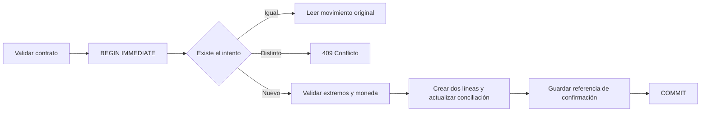

# Transferencias guiadas e idempotencia — ZA-90

`POST /api/transfers` recibe origen, destino e importe **positivo**. Genera las dos líneas mediante el servicio monetario existente y devuelve `{ transaction, lines }`. El cliente deja de construir signos opuestos. Admite cuentas distintas de la misma moneda y sobres diferentes de una misma cuenta. Las monedas distintas se rechazan: no existe un modelo de conversión trazable en el contrato actual.

```json
{
  "requestId": "4bcc05ce-b199-4ded-994e-94299e9dbf02",
  "userId": 1,
  "date": "2026-11-03",
  "description": "Ahorro del mes",
  "from": { "accountId": 1, "envelopeId": 11 },
  "to": { "accountId": 1, "envelopeId": 12 },
  "amount": 1234.56
}
```

`requestId` debe conservarse en cada reintento del mismo intento, sin modificar el cuerpo. El endpoint valida UUID, IDs enteros seguros, fecha contable real, descripción, importe representable y precisión de la moneda. El UUID se normaliza a minúsculas. La moneda proviene de las cuentas del servidor. Cuentas, instituciones y categorías deben pertenecer al `userId` declarado; siguen vigentes las validaciones de actividad y pertenencia de sobres del servicio existente. Este contrato conserva el modelo de identidad actual de la API: **no añade autenticación ni convierte userId en una credencial**.

## Confirmaciones durables

La tabla auxiliar `transfer_request` guarda `(user_id, request_id)`, hash SHA-256 del intento canónico y referencia al movimiento. No duplica importes, notas o saldos del libro. Su clave primaria tiene ámbito de usuario. Las referencias impiden eliminar el movimiento dejando una confirmación huérfana.



El bloqueo SQLite precede a la consulta de confirmación; dos conexiones de escritura no pueden aprobar simultáneamente una clave nueva. Movimiento, líneas, actualización de conciliaciones y confirmación participan en la misma transacción. Fallar al guardar la confirmación revierte la operación completa.

Un reintento idéntico devuelve el movimiento original con 201, incluso si posteriormente se desactivó una cuenta. Un mismo UUID con importe, fecha, descripción o extremos distintos devuelve `IDEMPOTENCY_CONFLICT` (409). Dos UUID distintos representan dos intenciones distintas, aunque tengan los mismos datos: no se aplica deduplicación heurística por importe/fecha. No borrar confirmaciones por TTL mientras se prometa recuperación del movimiento asociado.

`POST /api/transactions` continúa disponible para clientes anteriores. Su validación de transferencias también rechaza extremos idénticos. La garantía de reintento durable corresponde al nuevo endpoint con UUID; no se afirma que los clientes antiguos sin clave sean idempotentes.

## Preparación explícita para el bloque de testing

La aplicación **no crea ni migra esta tabla al arrancar o al recibir un POST**. Una instalación sin preparación devuelve `FEATURE_NOT_READY` (503) antes de escribir el libro; la web no deriva silenciosamente al endpoint anterior.

Durante el despliegue por bloques, respaldar y seleccionar explícitamente la base **de testing**, y preparar la tabla antes de promover las imágenes compatibles de API y web. El script no usa un DB_PATH predeterminado y rechaza archivos inexistentes. No ejecutarlo sobre la copia productiva de auditoría.

Desde un checkout con dependencias de desarrollo:

```powershell
npm run db:transfer-idempotency -- --db "RUTA_EXPLICITA_A_LA_BASE_DE_TESTING"
```

Dentro de la imagen API, en `/app`, usando la ruta real del volumen de testing:

```sh
node dist/scripts/enable-transfer-idempotency.js --db /ruta/real/testing.db
```

La preparación es aditiva y repetible: crea solo `transfer_request`, sus restricciones y la clave primaria. No recalcula saldos, convierte NUMERIC/TEXT, reescribe líneas o migra historia. No se ejecutó en una base del usuario durante ZA-90; las pruebas la habilitan exclusivamente en SQLite nuevas y sintéticas.

Para revertir el bloque, se pueden promover las imágenes anteriores y dejar la tabla auxiliar intacta. No eliminarla para recuperar compatibilidad: las rutas anteriores la ignoran. Si se vuelve a activar el nuevo flujo, conservar las confirmaciones evita duplicar reintentos anteriores. No hay un despliegue de testing por ticket.

## Pruebas

`tests/transfers.test.ts` utiliza una base temporal nueva y un servidor loopback. Comprueba líneas y saldos, traslado entre sobres, transferencia entre cuentas, conservación de bits históricos, confirmación descartada y reintentos concurrentes, nueva instancia del servicio, conflicto de intención, ámbitos por usuario, actividad/pertenencia, rechazo atómico, rollback por fallo al insertar confirmación y ausencia de cambios automáticos de esquema. La regresión previa sigue ejecutándose contra esquemas existentes, sin añadir tablas al arranque.

Ejecutar `npm run format:check`, `npm run lint`, `npm run type-check`, `npm test` y `npm run build`. El contrato también aparece en Swagger. La implementación no modifica `src/utils/money.ts` ni la política existente de saldos negativos; usa las validaciones monetarias del libro.
